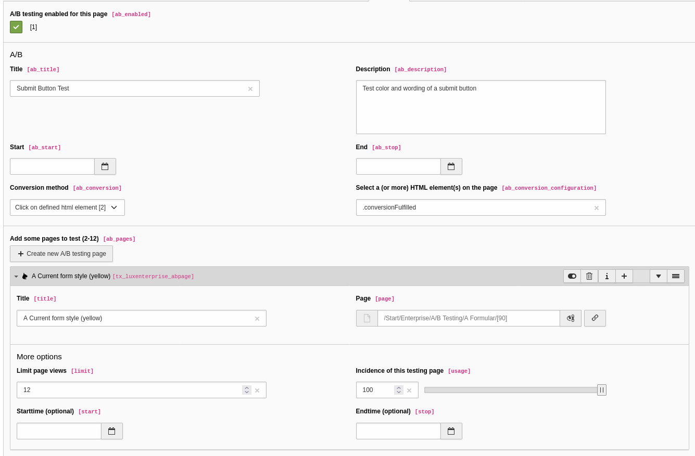
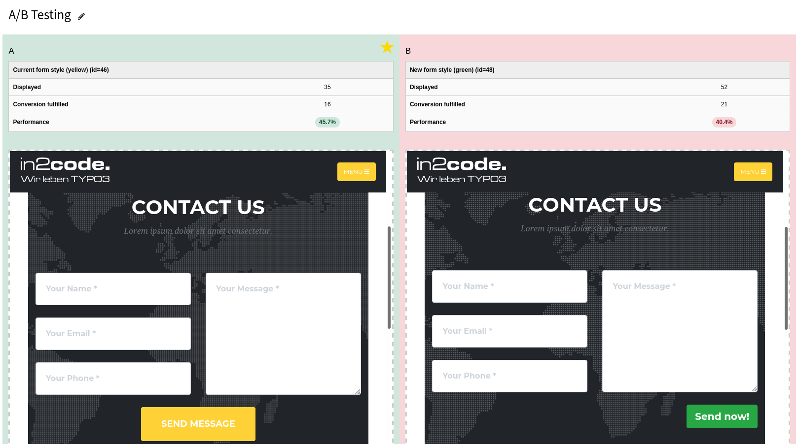

#### A/B testing

This part of the manual describes how to use A/B testing in TYPO3.

##### Functionality

This feature is based on page-wide A/B testing. This means that you have to add additional pages to a current existing
page and configure that page A or B (the new one) should be delivered randomly.

So first of all choose a page that you want to test (this is A). Copy this page, hide it in Navigation and
change only a few things on this page (this is B).

**Tipp:** For a meaningful test result you should consider not to change too much elements between two pages.
If you want to learn if a green or a blue button is clicked more often, don't change anything else than the color of
this specific button.

##### Configuration

If you open page settings in page A for editing properties as an editor, you will see a new tab called "Marketing".
In this tab you can check *A/B testing enabled for this page* to enable A/B tests.

After that you will see some more fields. Add a title, a description and two page records. Page record 1 with title A
and select the current page, that you are editing. Add a title to page record 2 and also select page B.
Read for your first test.



| Field                                          | Description                                                                                                                                                                                                                                   |
|------------------------------------------------|-----------------------------------------------------------------------------------------------------------------------------------------------------------------------------------------------------------------------------------------------|
| A/B testing enabled for this page              | A/B testing for this page is turned on in general                                                                                                                                                                                             |
| Title                                          | Name this test like "Button test"                                                                                                                                                                                                             |
| Description                                    | Add a description like "Test if button in blue is better then in green"                                                                                                                                                                       |
| Start                                          | Optional: Choose a date if this test should start in the future                                                                                                                                                                               |
| End                                            | Optional: Set an enddate if you want that this test stop automatically at a specific date                                                                                                                                                     |
| Conversion method                              | Select which visitor action leads to a conversion (Click on defined HTML element will open another field)                                                                                                                                     |
| Select a (or more) HTML element(s) on the page | Select one ore more HTML elements like `.class` or `#id` or `[data-foo="bar"]`                                                                                                                                                                |
| Add some pages to test                         | You need to add 2 up to 12 pages records here                                                                                                                                                                                                 |
| Page/Title                                     | Add a name for this page - like "Page A"                                                                                                                                                                                                      |
| Page/Page                                      | Select a page from the pagetree                                                                                                                                                                                                               |
| Page/Limit                                     | If you want to limit the number of views of this test in frontend, you can add a limit here                                                                                                                                                   |
| Page/Incidence of this testing page            | If all testing pages are set to 100, all are delivered with the same probability (as long as starttime and endtime doesn't exclude the rendering). You can reduce the probability of single pages if you don't want to deliver them that ofen |
| Page/Starttime (optional)                      | If this page should be shown in future only, select a date                                                                                                                                                                                    |
| Page/Endtime (optional)                        | If delivering this page should be stopped automatically at a specific date, select a date                                                                                                                                                     |

##### Results

Once you have activated A/B tests in page properties, you will see a result in pageoverview:



| Value                | Description                                                                              |
|----------------------|------------------------------------------------------------------------------------------|
| Displayed            | All deliveries of this variant - also without opt-in. Limits of variants refer to this. |
| Thereof with opt-in  | Visits of visitors with an active tracking (opt-in or autoenable)                        |
| Conversion fulfilled | Conversions - they are only tracked with an opt-in                                       |
| Performance          | Conversions in relation to the visits with opt-in                                        |

**Note:** Since conversions are only tracked with an opt-in, the conversion rate (performance) and the winner of a
test only relate to visits with opt-in (since luxenterprise 53.0.0). So the rate does not depend on the opt-in rate
of your website. The detail table in the backend module and its CSV export show hits, hits with opt-in and
conversions per variant.


##### Backend module

In the backend module you will see all active A/B tests with a short overview about their performance.
Buttons allows you to change to edit view of a page or to pageoverview module with that page.


##### Technical notes

###### Counting without opt-in

Since luxenterprise 53.0.0 an A/B testing visit is counted on the server when the variant is delivered - without
visitor, IP address or user agent. A not guessable reference to this visit is written into the attribute
`data-lux-abpagevisit`. LUX JavaScript sends no request without an opt-in. With an opt-in, it sends the reference and
the visitor is added to the counted visit, so there is no second record. The reference expires after 30 minutes,
a forged reference or the reference of another visitor is refused. Conversions are only stored for the visit of the
visitor of the request.

Not counted are:

* Crawlers and requests without user agent (they get the original page)
* Previews with parameter `?luxabtest=b` (e.g. in the page module)
* Prefetch, prerender and preview requests of browsers (headers `Sec-Purpose`, `Purpose`, `X-Purpose`, `X-Moz`)

Without an opt-in every delivery is counted, also a reload of the page, because there is no cookie that keeps the
variant.

**Note:** Pages that are cached by a reverse proxy or CDN (e.g. Varnish) do not reach TYPO3 and are not counted.
LUXenterprise already excludes A/B testing pages from staticfilecache.

**Upgrade:** Older versions created a visitor without fingerprint for every A/B testing visit without opt-in. Run the
upgrade wizard `anonymousAbTestingVisitorsUpdateWizard` once after the update to remove these visitors. Their visits
are kept without visitor:
```
vendor/bin/typo3 upgrade:run anonymousAbTestingVisitorsUpdateWizard
```

###### Cookie and consent

The selected variant is stored in a cookie per A/B test to show the same variant on further page visits. The cookie
name contains the uid of the page with the test (e.g. `LUXABTEST_123` for the test on page 123), the value is the
variant (`A`, `B`, etc.). So parallel tests are independent of each other.

The cookie is set by LUX JavaScript only if tracking is active (autoenable or opt-in) with `SameSite=Lax` (and
`Secure` on HTTPS). Without consent, a variant is shown, but no cookie is set - so a visitor could see another variant
on the next page visit. No cookie is set for previews (e.g. in the backend module) with parameter `?luxabtest=b`.

By default the cookie is a session cookie. You can set a lifetime in days via an ENV variable:
```
LUXENTERPRISE_ABTESTING_COOKIE_LIFETIME=30
```

**Note:** If you set a lifetime, please add the cookie with its lifetime to your consent tool and your privacy
statement. Safari limits cookies that are set via JavaScript to 7 days.

###### Enforce a variant

You can simply add a new (or rename an existing) cookie with name `LUXABTEST_123` (uid of the page with the test) and
set the value to `A` or `B` etc.

`LUXABTEST_123=B`

The old global cookie `LUXABTEST=B` is still respected as fallback for all tests, if there is no cookie for the test
itself. But it is not set any more.

**Note:** The letters `A`, `B`, `C`, etc. are given by the position of the variants in the test. If you delete a
variant or change the order of the variants of a running test, the following letters move up. A visitor with a cookie
value `B` will then see the variant that was `C` before. Disabled variants keep their letter.

###### Backend User Sections or Frontend Authentication

We already support also A/B Testing in "Backend User Sections" or on pages with "Frontend Authentication".
If you want to use a Testing within such an area, the server itself will read the A or B target with a CURL-request. If
session cookies for frontend or backend login is given, it will be passed in those requests.

Nevertheless the IP address of the user may be different to the server and this is checked from TYPO3 by default.
You can disable this check if you need it:

```
# For calling pages of type "Backend User Sections"
$GLOBALS['TYPO3_CONF_VARS']['BE']['lockIP'] = 0;
$GLOBALS['TYPO3_CONF_VARS']['BE']['lockIPv6'] = 0;

# For calling pages of with a frontend authentication
$GLOBALS['TYPO3_CONF_VARS']['FE']['lockIP'] = 0;
$GLOBALS['TYPO3_CONF_VARS']['FE']['lockIPv6'] = 0;
```

###### Basic Auth credentials for A/B pages needed

You can simply add ENV variables to support basic authentication like (since luxenterprise 46.2.0):
```
LUXENTERPRISE_ABTESTING_AUTH_USER=username
LUXENTERPRISE_ABTESTING_AUTH_PASS=password
```

###### Timeout for loading variants

To deliver a variant, the server reads the target page with a request to its own public URL (if the selected variant
is the current page, the already rendered page is used and no request is needed). If a variant could not be loaded
(e.g. because of a timeout), the original page is delivered and an error is logged (since luxenterprise 50.2.0).

By default the global HTTP timeout of TYPO3 is used (`$GLOBALS['TYPO3_CONF_VARS']['HTTP']['timeout']`, which is
unlimited by default). You can set an own timeout in seconds for these requests via an ENV variable
(since luxenterprise 50.2.0):
```
LUXENTERPRISE_ABTESTING_TIMEOUT=5
```
