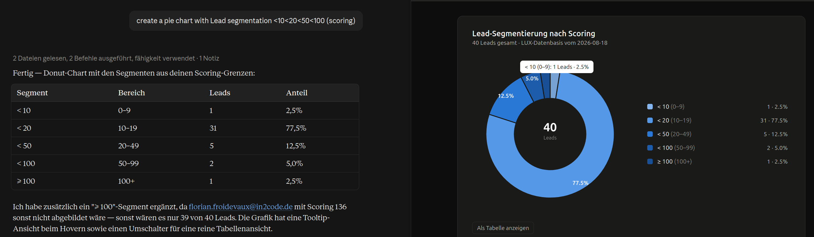

# MCP server of LUXenterprise

**NOTE:** This mcp is only part of the enterprise version

LUXenterprise offers a [MCP](https://modelcontextprotocol.io) server (Model Context Protocol), so that AI clients
like Claude Code, Claude Desktop, VS Code or any other MCP client can read the marketing data of your TYPO3
installation. All tools that are used by the AI chatbot of LUXenterprise are automatically offered as MCP tools.

---

## Configuration

### Prerequisites
You need to enable the MCP server in the backend settings first. See [For Administrators](#for-administrators).

### 1. Create an api key

Every backend user has its own api key. The easiest way to create one is the CLI command:

```bash
vendor/bin/typo3 lux:mcpapikey <uid|username>     # creates a new key and prints it once together with the server url
vendor/bin/typo3 lux:mcpapikey <uid|username> -r  # revokes the key
```

A key has the format `<uid>.<secret>`, e.g. `4.AbC123…` for the backend user with uid 4. Only the secret is stored,
as a hash, and can never be read back. Creating a new key replaces the previous one. The secret uses a url safe
alphabet (`A-Z a-z 0-9 - _`), so the key needs no quoting in a shell or a json file.

Alternatively, the secret can be generated in the backend user record (field "Lux MCP Server API Key"). Copy it
before saving the record and **put the uid of the backend user and a dot in front of it** - the field itself only
holds the secret, which needs at least 64 characters:


A MCP client acts with the permissions of the backend user of the api key, so the data of the tools is restricted
in the same way as in the LUX backend modules. Deleting the api key of a backend user (or disabling the user)
revokes the access immediately.

**Editors need a group permission:** an api key alone is not enough for a backend user who is no administrator.
One of the backend groups of the user has to allow "Use MCP clients with an api key" (tab "Access Rights",
"Custom module options", section "LUX enterprise MCP server"). Administrators always may.

**Upgrade from an earlier version:** keys created before LUXenterprise 51 have no uid part. Put the uid of the
backend user and a dot in front of the existing key, or create a new one with `lux:mcpapikey`. A key that was set
by hand with less than 64 characters has to be replaced.

### 2. Connect a client

Example for a registration in Claude Code:

```bash
claude mcp add --transport http luxenterprise https://your-domain.org/typo3/mcp/lux \
  --header "Api-Key: <apikey>"
```

Example for a configuration file of a MCP client:

```json
{
  "mcpServers": {
    "luxenterprise": {
      "type": "http",
      "url": "https://your-domain.org/typo3/mcp/lux",
      "headers": {
        "Api-Key": "<apikey>"
      }
    }
  }
}
```

A quick check on command line:

```bash
curl -X POST https://your-domain.org/typo3/mcp/lux \
  -H 'Content-Type: application/json' \
  -H 'Api-Key: <apikey>' \
  -d '{"jsonrpc":"2.0","id":1,"method":"initialize","params":{"protocolVersion":"2025-06-18","capabilities":{},"clientInfo":{"name":"curl","version":"1.0"}}}'
```

The server uses the streamable HTTP transport of MCP (`POST` requests with json-rpc messages) and expects the api
key in one of these headers:

```
Authorization: Bearer <apikey>
Api-Key: <apikey>
```

The `Api-Key` header is a fallback for webserver configurations that do not pass the authorization header to php
(e.g. apache with `mod_proxy_fcgi` without `CGIPassAuth On`).

## First steps

After the MCP server is activated, and the MCP server is configured in your LLM, the server is ready to use.
Now you can use your client to fetch and analyze any lux-related data from your instance.

To get an idea about what you can do with the mcp server, ask your LLM client: `What tools are provided by lux?`
From there you can explore the capabilities of the MCP server.

Here is an example Screenshot of a chat displaying a chart based on the current leads scoring in the instance:



## For Administrators

### Activate the MCP server

| Setting               | Description                                                   | Default |
|-----------------------|---------------------------------------------------------------|---------|
| `mcpServer`           | Activates the MCP server                                      | `0`     |
| `mcpServerAllowedIps` | Client addresses that may use the endpoint, `*` for every one | `*`     |

The endpoint of the server is `/typo3/mcp/lux`. It is located in the backend context, because the tools of
LUXenterprise need a backend user to decide which visitors and pages can be read.

### Restricting the client addresses

`mcpServerAllowedIps` is a comma separated list of addresses or ranges - CIDR like `192.168.0.0/24` and
`2001:db8::/32`, or wildcards like `192.168.*.*`, as `GeneralUtility::cmpIP()` reads them. A request from any
other address is answered with `403` before its api key is even looked at, so it does not count as a failed
authentication either. `*` (the default) and an empty value allow every address. The setting `apiKeyIpAllowList`
only applies to the REST interface of LUXenterprise, not to the MCP server.

Which addresses a client connects from depends on where it runs:

- **claude.ai** (and connectors added there) calls the server from the cloud of Anthropic. Its outbound ranges are
  published at https://platform.claude.com/docs/en/api/ip-addresses - at the time of writing `160.79.104.0/21` and
  `153.61.208.0/20`, IPv4 only. Anthropic announces changes there.
- **Clients on a computer**, like Claude Code, connect from the address of that computer or of its network, for
  example the office or the VPN.

Example for claude.ai plus the office network:

```php
$GLOBALS['TYPO3_CONF_VARS']['EXTENSIONS']['luxenterprise']['mcpServerAllowedIps']
    = '160.79.104.0/21,153.61.208.0/20,203.0.113.0/24';
```

**The IP restriction of the TYPO3 backend applies as well.** The endpoint lives below `/typo3`, so
`$GLOBALS['TYPO3_CONF_VARS']['BE']['IPmaskList']` is checked by the core before LUXenterprise runs. If an
installation restricts the backend to the office, a client from anywhere else gets `403` from TYPO3 - for claude.ai
the ranges above have to be added to `IPmaskList` too, otherwise `mcpServerAllowedIps` never gets the chance to
allow them. Behind a proxy both lists only see the real client when `[SYS][reverseProxyIP]` is configured.

### Rate limiting

The rate limit can be configured with
`$GLOBALS['TYPO3_CONF_VARS']['SYS']['rateLimiter']['luxenterprise-mcp']` (keys `limit` and `interval`).
A successful authentication resets the limit, so only failing requests are counted. An IPv6 client is counted per
/64 network, because even a home connection gets one of them. The counter is raised under a lock, so a burst of
parallel requests can not pass the limit.

Behind a reverse proxy, configure `$GLOBALS['TYPO3_CONF_VARS']['SYS']['reverseProxyIP']` - otherwise every
client is counted as the address of the proxy.

### Security

- **Key format:** A key names its backend user (`<uid>.<secret>`), so exactly one password hash is verified per
  request. A key that does not match the format (or a secret shorter than 64 characters) is refused before any
  database lookup or hash check.
- **Maintenance mode:** `[BE][adminOnly]` is respected - while the backend is locked for editors, their MCP
  requests are refused as well.
- **No login side effects:** A MCP request is not handled as a backend login. No login notification mail is sent,
  a pending password reset of the user stays valid and records the user is editing in the backend stay locked.
- **Multi factor authentication** does not apply: a client without a browser can not solve a second factor, the
  api key itself is the credential. Treat it like a password and create one key per person.
- **Personal data:** A MCP client sees the same data as the backend user in the LUX modules - including email
  addresses and ip addresses of leads. The parameter `include_pii` of `lux_lead` (and the `fields` of
  `lux_query`) only keeps personal data out of a conversation that does not need it, it is **no permission**.
  Data that is read by a client is passed to the provider of the AI model the client uses. Only give MCP access
  to backend users that may hand over these data.
- **Content of visitors can carry instructions for the model** (prompt injection). UTM parameters, referrers,
  search terms, form values or company data are entered by anonymous visitors and end up in the context of the
  model as soon as a tool reads them. This can not be solved on the server. All tools only read and are marked
  with the MCP annotations `readOnlyHint: true` and `openWorldHint: false`, and the server instructions tell the
  model to treat these values as data. Recommendation: do not let a client that also has tools to send mails,
  fetch urls or write somewhere run tools without confirmation, as long as it is connected to LUX.

### Error responses

| Status | Meaning                                                                                     |
|--------|---------------------------------------------------------------------------------------------|
| `401`  | No, a malformed or an invalid api key was sent                                               |
| `403`  | The client address is not allowed, no backend group of the user allows MCP, or the backend is locked by `[BE][adminOnly]` |
| `429`  | Too many failed authentications from this ip address or IPv6 /64 (20 in 15 minutes by default) |
| `405`  | The request method is not supported (only `POST`, `DELETE` and `OPTIONS`)                     |


---
